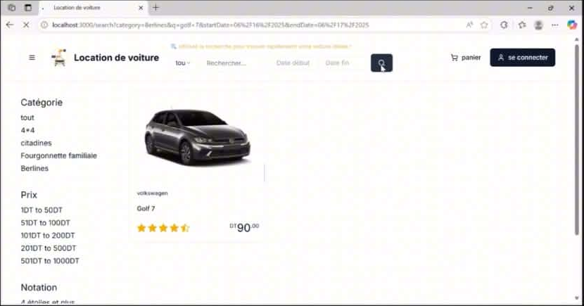
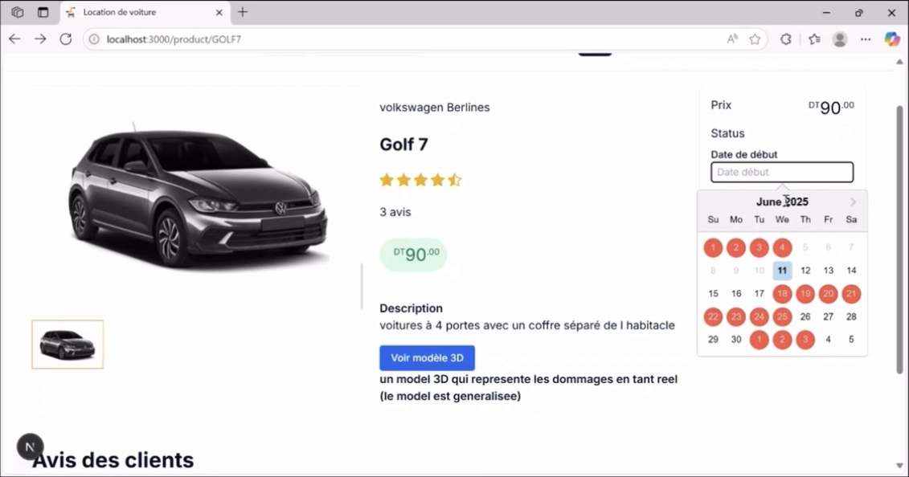
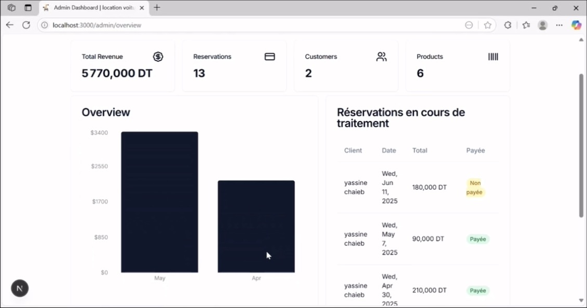

# Plateforme de location de voitures

Application web de location de voitures développée dans le cadre d'un projet de fin d'études (PFE) par Yassine Chaieb.
Les clients parcourent le catalogue, choisissent une voiture, réservent sur des dates précises et paient en ligne. Un espace d'administration permet de gérer les voitures, les utilisateurs et les réservations.

## Table des matières

- [Captures d'écran](#captures-décran)
- [Fonctionnalités](#fonctionnalités)
- [Technologies utilisées](#technologies-utilisées)
- [Structure du projet](#structure-du-projet)
- [Modèle de données](#modèle-de-données)
- [Prérequis](#prérequis)
- [Installation](#installation)
- [Variables d'environnement](#variables-denvironnement)
- [Base de données](#base-de-données)
- [Lancement](#lancement)
- [Tests](#tests)
- [Emails](#emails)
- [Comptes de démonstration](#comptes-de-démonstration)
- [Auteur](#auteur)

## Captures d'écran

### Partie client

**Page d'accueil** : bandeau de présentation et liste des nouveautés.


**Recherche et filtres** : recherche par mot-clé et par dates, filtres par catégorie, prix et notation.



**Détail d'une voiture et réservation** : calendrier avec les jours indisponibles en rouge, prix par jour, description, avis des clients et accès au modèle 3D.



### Partie administrateur

**Tableau de bord** : chiffre d'affaires, nombre de réservations, de clients et de voitures, graphique mensuel et réservations en cours de traitement.



## Fonctionnalités

### Espace client

- Catalogue de voitures avec images, marque, prix par jour (en dinars tunisiens, DT), note et nombre d'avis
- Recherche par mot-clé et par dates, avec filtres par catégorie (citadines, berlines, 4x4, fourgonnettes familiales), par tranche de prix et par notation
- Page détail d'une voiture avec galerie d'images et avis des clients
- Modèle 3D de la voiture pour visualiser les dommages (modèle générique)
- Calendrier de réservation qui signale les jours déjà réservés
- Réservation sur une période choisie (date de début et de fin), avec calcul automatique du nombre de jours et du prix total
- Parcours de commande en plusieurs étapes : panier, adresse, moyen de paiement, validation
- Paiement en ligne par PayPal ou Stripe
- Création de compte, connexion et gestion du profil
- Historique des réservations de l'utilisateur
- Avis et notes sur les voitures louées
- Reçu de réservation envoyé par email
- Mode clair et mode sombre

### Espace administrateur

- Tableau de bord avec statistiques et graphiques
- Gestion des voitures : création, modification, suppression, envoi d'images
- Gestion des utilisateurs et de leurs rôles
- Suivi des réservations : état du paiement et de la livraison
- Accès protégé : seuls les comptes ayant le rôle `ADMIN` peuvent entrer

## Technologies utilisées

| Domaine | Outils |
|---|---|
| Framework | Next.js 15 (App Router), React 19, TypeScript |
| Interface | Tailwind CSS, Radix UI, shadcn/ui, Lucide, Recharts |
| Formulaires | React Hook Form, Zod |
| Base de données | PostgreSQL (Neon), Prisma |
| Authentification | NextAuth (Auth.js) v5 |
| Paiement | PayPal, Stripe |
| Upload d'images | UploadThing |
| Emails | Resend, React Email |
| Tests | Jest, ts-jest |

## Structure du projet

```
naimapfe/
├── app/
│   ├── (auth)/          # Connexion et inscription
│   ├── (root)/          # Pages publiques : accueil, recherche, voiture, panier, commande, réservation
│   ├── admin/           # Espace administrateur (tableau de bord, voitures, utilisateurs, réservations)
│   ├── user/            # Espace utilisateur (profil, mes réservations)
│   └── api/             # Routes API : NextAuth, UploadThing, webhook Stripe
├── components/          # Composants (admin, réservation, partagés, interface) et captures d'écran du README
├── db/                  # Client Prisma, données d'exemple et script de seed
├── email/               # Modèles d'emails (reçu de réservation)
├── hooks/               # Hooks React
├── lib/                 # Actions serveur, validateurs, PayPal, chiffrement, utilitaires
├── prisma/              # Schéma et migrations
├── public/              # Fichiers statiques et images
├── tests/               # Tests Jest
├── types/               # Types TypeScript
├── auth.ts              # Configuration NextAuth
├── auth.config.ts
└── middleware.ts        # Protection des routes
```

## Modèle de données

Le schéma Prisma contient les modèles suivants :

- **Product** : une voiture (nom, marque, catégorie, images, description, prix par jour, stock, note, mise en avant)
- **User** : un utilisateur (nom, email, mot de passe chiffré, rôle, adresse, moyen de paiement)
- **Reservation** : une réservation (voiture, utilisateur, dates, nombre de jours, prix total, état du paiement et de la livraison)
- **Review** : un avis (note, titre, commentaire)
- **Cart** : le panier
- **Account**, **Session**, **VerificationToken** : tables utilisées par NextAuth

## Prérequis

- Node.js 18 ou supérieur
- npm
- Une base de données PostgreSQL (le projet utilise Neon)
- Des comptes de test PayPal, Stripe, UploadThing et Resend pour les fonctions correspondantes

## Installation

```bash
git clone https://github.com/chaiebyassine/naimapfe.git
cd naimapfe
npm install
```

La commande `npm install` génère automatiquement le client Prisma.

## Variables d'environnement

Copiez le fichier d'exemple, puis renseignez chaque valeur :

```bash
cp .example-env .env
```

| Variable | Description |
|---|---|
| `NEXT_PUBLIC_APP_NAME` | Nom de l'application |
| `NEXT_PUBLIC_APP_DESCRIPTION` | Description de l'application |
| `NEXT_PUBLIC_SERVER_URL` | URL du site (ex. `http://localhost:3000`) |
| `DATABASE_URL` | Chaîne de connexion PostgreSQL |
| `NEXTAUTH_SECRET` | Clé secrète pour les sessions |
| `NEXTAUTH_URL` | URL utilisée par NextAuth |
| `NEXTAUTH_URL_INTERNAL` | URL interne utilisée par NextAuth |
| `PAYMENT_METHODS` | Moyens de paiement acceptés (ex. `PayPal, Stripe`) |
| `DEFAULT_PAYMENT_METHOD` | Moyen de paiement par défaut |
| `PAYPAL_API_URL` | URL de l'API PayPal (sandbox ou production) |
| `PAYPAL_CLIENT_ID` | Identifiant client PayPal |
| `PAYPAL_APP_SECRET` | Clé secrète PayPal |
| `UPLOADTHING_TOKEN` | Jeton UploadThing |
| `UPLOADTHING_SECRET` | Clé secrète UploadThing |
| `UPLOADTHING_APPID` | Identifiant de l'application UploadThing |
| `NEXT_PUBLIC_STRIPE_PUBLISHABLE_KEY` | Clé publique Stripe |
| `STRIPE_SECRET_KEY` | Clé secrète Stripe |
| `RESEND_API_KEY` | Clé API Resend |
| `SENDER_EMAIL` | Adresse d'expédition des emails |

Ne publiez jamais le fichier `.env` sur GitHub.

## Base de données

Appliquer les migrations :

```bash
npx prisma migrate deploy
```

En développement, vous pouvez utiliser à la place `npx prisma migrate dev`.

Remplir la base avec des voitures et des comptes de démonstration :

```bash
npx ts-node db/seed.ts
```

Attention : le script de seed supprime d'abord les voitures, les utilisateurs, les comptes et les sessions existants.

## Lancement

Mode développement :

```bash
npm run dev
```

L'application est disponible sur [http://localhost:3000](http://localhost:3000).

Version de production :

```bash
npm run build
npm start
```

Pour recevoir les confirmations de paiement Stripe en local, redirigez les webhooks vers la route `/api/webhooks/stripe` avec la CLI Stripe.

## Tests

```bash
npm test
```

Pour relancer les tests à chaque modification :

```bash
npm run test:watch
```

## Emails

Pour prévisualiser les modèles d'emails en local (port 3001) :

```bash
npm run email
```

## Comptes de démonstration

Après le seed, deux comptes sont disponibles :

| Rôle | Email | Mot de passe |
|---|---|---|
| Administrateur | `admin@example.com` | `admin123` |
| Utilisateur | `john@example.com` | `test123` |

Ces comptes sont réservés au développement. Supprimez-les ou changez leurs mots de passe avant toute mise en ligne.

## Auteur

**Yassine Chaieb** : [@chaiebyassine](https://github.com/chaiebyassine)

Projet de fin d'études (PFE).
